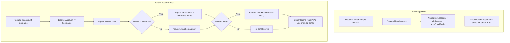
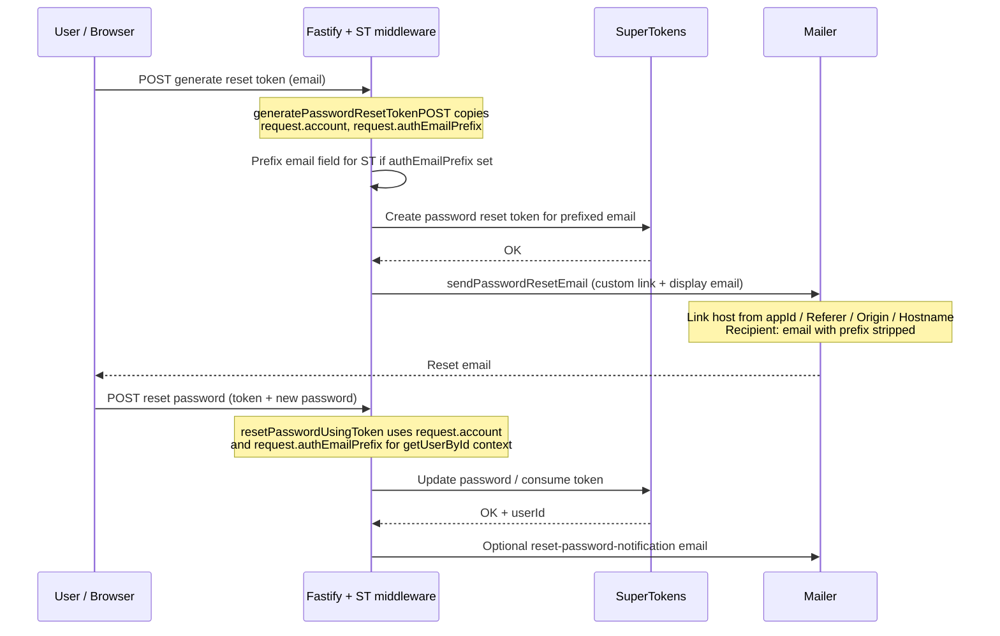

# Reset Password Flow

This document explains how password reset works for **admin** users versus **tenant** (SaaS account) users in this monorepo, with the same assumptions as `user_creation_flow.md`: app profiles live in `users`, and SuperTokens owns credentials and reset tokens.

Typical `saas` config shape (for context—see your app’s `ApiConfig`):

- `saas.mainApp.domain` / `saas.mainApp.subdomain`: main self-service app host.
- `saas.apps`: optional extra apps (for example **admin**), each with `domain` / `subdomain`.
- `saas.subdomains`: how hostnames are interpreted (`required` implies real account hosts are expected).
- `saas.multiDatabase.mode` and `saas.multiDatabase.migrations.path`: whether accounts can use a dedicated DB schema and where account migrations live.

## Components Involved

- `saas/packages/fastify`: account discovery hook, SuperTokens recipe overrides for email/password.
- `@prefabs.tech/fastify-user`: email sending helpers, reset link path helpers.
- SuperTokens `thirdpartyemailpassword`: token generation, password update, internal user id.

## Request Context Before `/auth/*`

`accountDiscoveryPlugin` runs on every request unless the host matches a configured **`saas.apps`** entry (for example the admin UI), in which case it **returns immediately** and does **not** set `request.account`, `request.dbSchema`, or `request.authEmailPrefix`.

For other hosts, discovery runs. Defaults in `saas/packages/fastify/src/config.ts` include **`/^\/auth\//`** in `excludeRoutePatterns`:

- **Main app host** (`hostname === saas.mainApp.domain`): if the URL matches an excluded pattern (including `/auth/...`), `discoverAccount` **returns no account** (header-based lookup is skipped in that branch). So `request.account` / `request.authEmailPrefix` are usually **unset** on SuperTokens routes under `/auth/` for the main app host.
- **Tenant account host** (custom domain or account subdomain): account is resolved **by hostname** even for `/auth/...` routes, so `request.account` and (when applicable) `request.authEmailPrefix` and `request.dbSchema` are set as below.

When an account is resolved and `account.database` is set (tenant schema name, for example `s_xxxxxxxx`), the plugin sets:

- `request.dbSchema = account.database`

When the account has a `slug`, it sets:

- `request.authEmailPrefix = "${account.id}_"` (SuperTokens “logical” email uses this prefix; see `user_creation_flow.md`).

## High-Level Flow (Admin vs Tenant)

## End-to-End Reset Sequence

## Detailed Steps

### 1) Request reset token (`generatePasswordResetTokenPOST`)

Source path: `saas/packages/fastify/src/supertokens/recipes/third-party-email-password/generatePasswordResetTokenPost.ts`

- Copies `input.userContext.account` and `input.userContext.authEmailPrefix` from the Fastify request (`input.options.req.original`).
- Applies `updateFields` so the **`email` form field** is prefixed with `authEmailPrefix` when the tenant uses slug-based isolation (matches signup/signin behavior).
- Delegates to SuperTokens to issue the token (stored in SuperTokens tables, not in `users`).

### 2) Deliver email (`sendPasswordResetEmail`)

Source path: `saas/packages/fastify/src/supertokens/recipes/third-party-email-password/sendPasswordResetEmail.ts`

- Rewrites SuperTokens’ default reset URL to a host derived from:
  - `?appId=` (resolved to `config.apps`), or else
  - `Referer` / `Origin` / `hostname`.
- Sends the message to the **human-readable** address using `Email.removePrefix` with `userContext.authEmailPrefix`.

### 3) Complete reset (`resetPasswordUsingToken`)

Source path: `saas/packages/fastify/src/supertokens/recipes/third-party-email-password/resetPasswordUsingToken.ts`

- After SuperTokens reports `OK`, loads the user again with `getUserById` and passes through `request.account` and `request.authEmailPrefix` so **display email** matches other recipe overrides.
- Sends a **“password changed”** notification email when configured (`resetPasswordNotification` templates / subjects in `fastify.config.user.emailOverrides`).

### 4) `getUserById` display email

Source path: `saas/packages/fastify/src/supertokens/recipes/third-party-email-password/getUserById.ts`

- Strips `authEmailPrefix` from emails returned to callers when a prefix is in context.

## Multi-Database (`account.database`)

- Tenant schema selection for **app tables** (`users`, `__account_users`, etc.) follows `request.dbSchema` / `account.database`, as in `user_creation_flow.md` and `runAccountMigrations`.
- The **password reset token and password hash** remain in SuperTokens’ store; resetting a password does not migrate rows in `users` by itself.
- Consistency matters: signup/signin and reset must agree on whether the SuperTokens email is **prefixed** (`authEmailPrefix`) for that account. Tenants resolved **by hostname** get that context on `/auth/*` routes; admin-app traffic does not.

## Source File Index

| Concern | Location |
|--------|----------|
| Account discovery, `dbSchema`, `authEmailPrefix` | `saas/packages/fastify/src/plugins/accountDiscoveryPlugin.ts` |
| Main vs header vs hostname discovery | `saas/packages/fastify/src/lib/discoverAccount.ts` |
| Default excluded routes (`/auth/`, etc.) | `saas/packages/fastify/src/config.ts` |
| Reset token API override | `.../third-party-email-password/generatePasswordResetTokenPost.ts` |
| Email delivery override | `.../third-party-email-password/sendPasswordResetEmail.ts` |
| Consume token + notification | `.../third-party-email-password/resetPasswordUsingToken.ts` |
| Recipe wiring | `saas/packages/fastify/src/supertokens/recipes/index.ts` |

## Quick Verification Checklist

- **Tenant user** (account host, slug): submit reset with unprefixed email in the form; SuperTokens receives prefixed email; email arrives unprefixed; completing reset succeeds when the browser/API uses the **same host** context as token generation.
- **Admin user** (dedicated `saas.apps` domain): no tenant `account` on the request; SuperTokens email has **no** tenant prefix—matches how that user was provisioned.
- **Multi-database**: after reset, sign-in still loads profile via `users` using the tenant schema implied by `account.database` during session creation (see `createNewSession` and sign-in recipes)—password change alone should not blank profile data.
